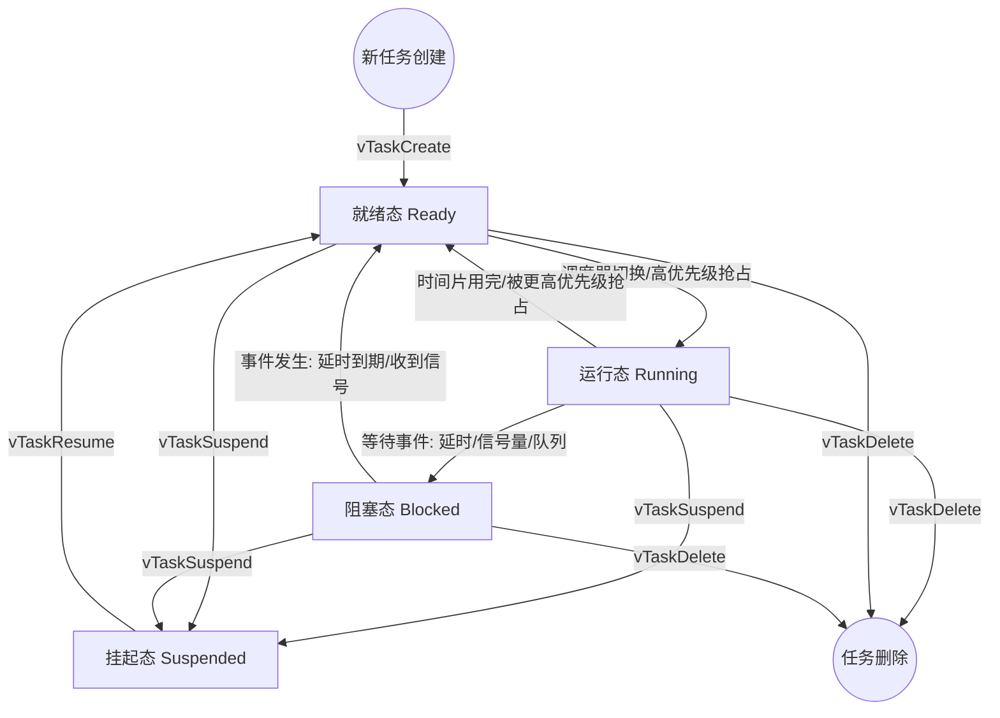
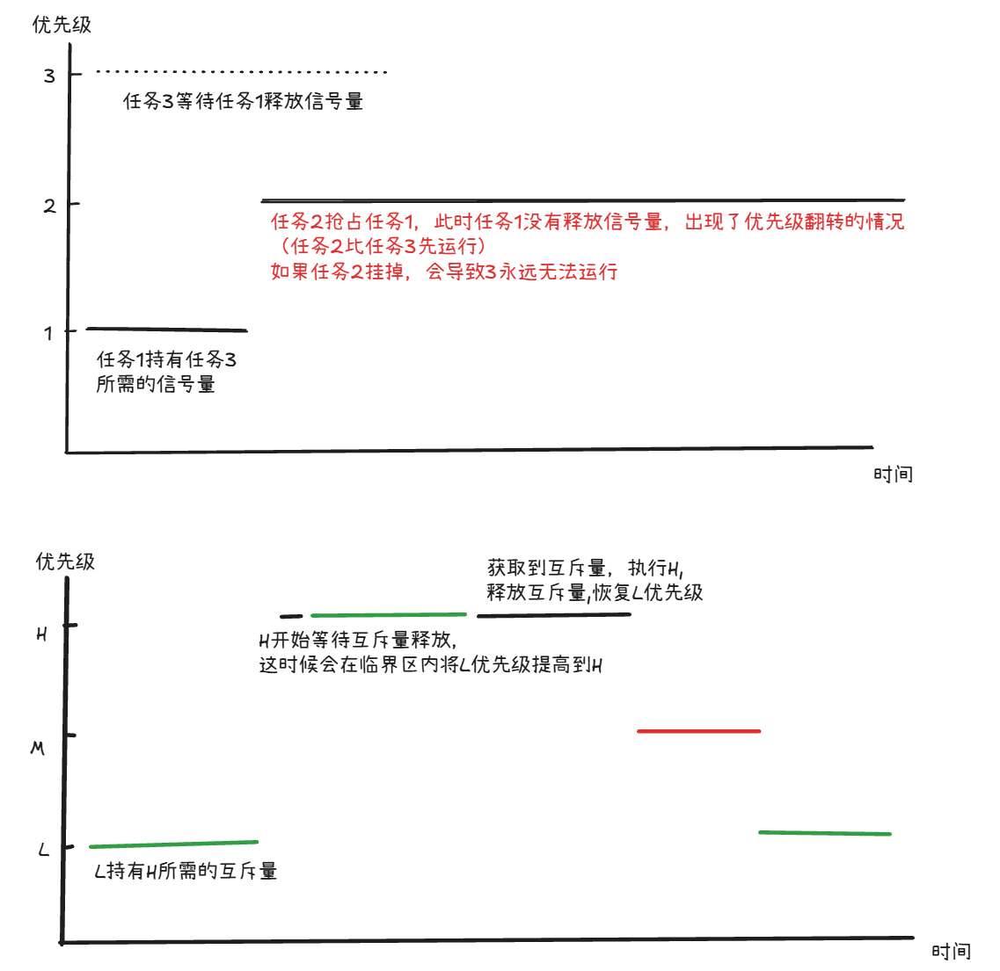
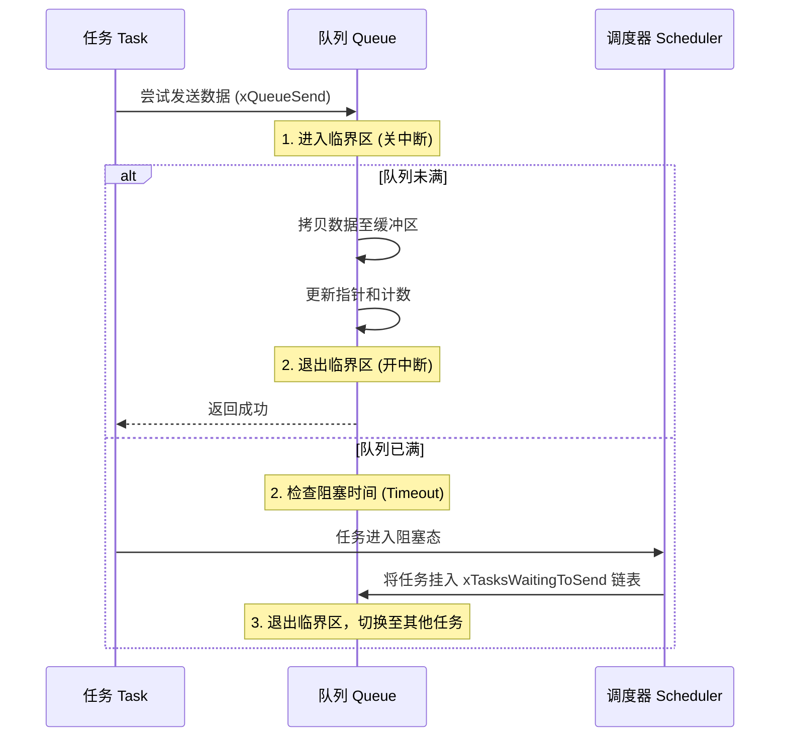
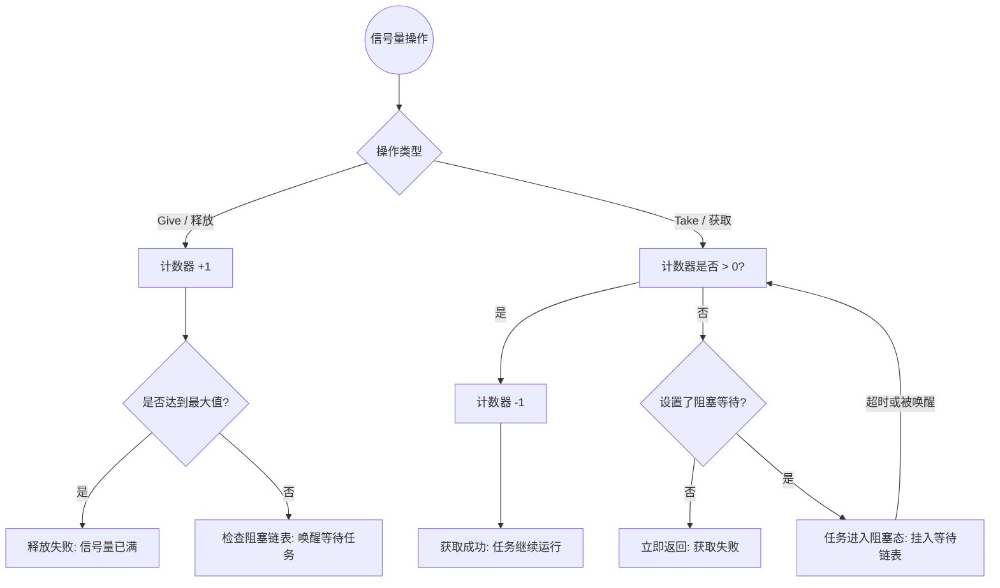
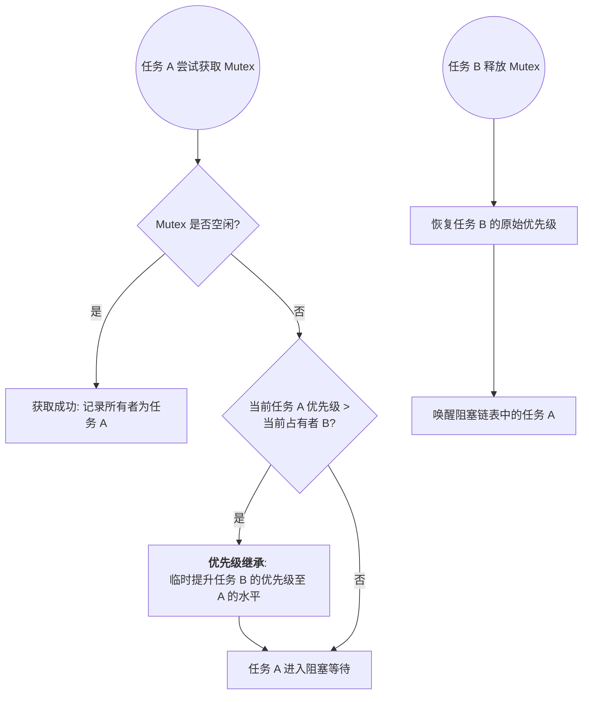
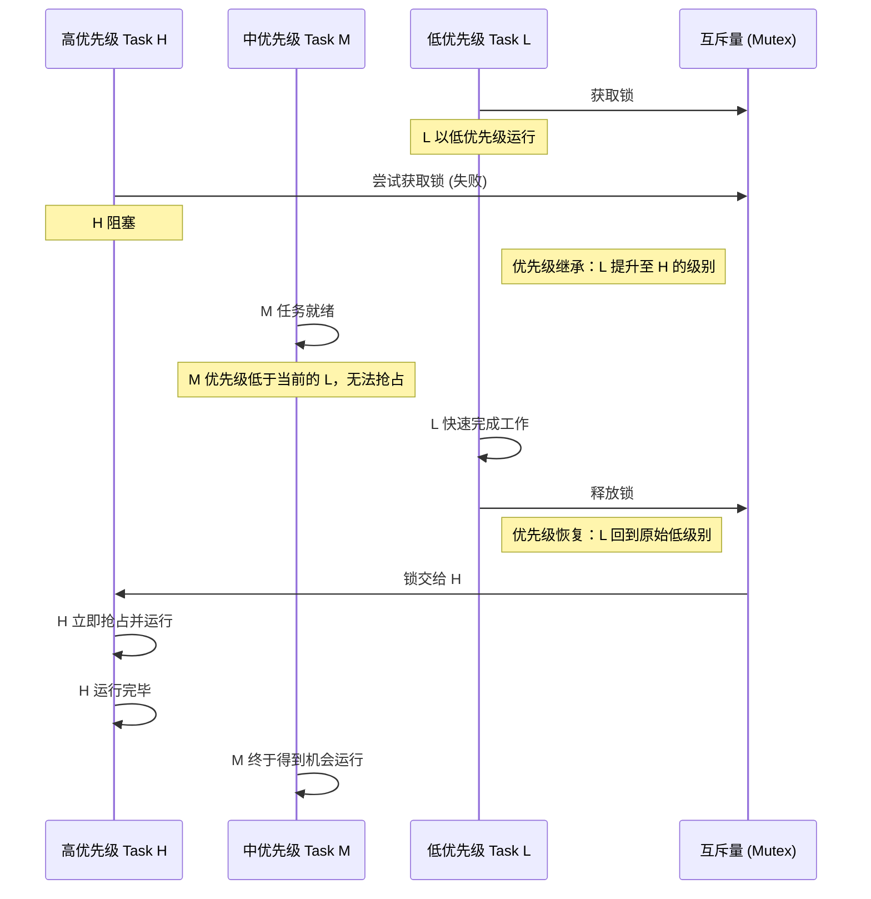

# 韦东山FreeRtos

[视频链接](https://www.bilibili.com/video/BV1Ar4y1C7En?spm_id_from=333.788.player.switch&vd_source=2e33a3cba9dea05126d330dcf100be27&p=3)

## 常用汇编

| 汇编                | 例子            | 说明                                                         |
| ------------------- | --------------- | ------------------------------------------------------------ |
| LDR(load register)  | LDR R3,[R2,#00] | R3为**目标寄存器**，R2原寄存器地址，#00为偏移。例子表示加载R2寄存器到R3寄存器 |
| STR(store register) | STR R3,[R2,#00] | 例子为设置R3的值到R2寄存器                                   |
| PUSH                | PUSH  {r3,lr}   | 将寄存器值压入栈，压入顺序按照寄存器编号从大到小进行写入。和括号内的顺序无关 |
| POP                 | POP    {r3,lr}  | 将栈的数据取出，顺序从低地址开始取出。即先获得R3值，SP+4后在获取LR的值 |
| MOV                 | mov	r5, r0   | r5:目标寄存器，r0源寄存器/立即数，mov将源寄存器/立即数的值赋值给目标寄存器 |

## 栈的作用

用来保存现场与恢复现场。

### 如何保存现场？

当程序出现中断时，需要保存当前的R0~R15，xPSR寄存器到SP内。**注意，SP（R13）不需要保存到栈里边，因为其本身就是栈**

当退出中断时，需要将保存的R0~R15,xPSR寄存器从SP内恢复到各自寄存器。

其中R0~R4,R12,LR,PC,XPSR由内核自动入栈，出栈。

软件保存或取出R5~R11。

#### rtos保存现场流程：

这个流程**一般在PendSV**内进行

| **步骤**        | **动作类型** | **执行内容**                  | **结果**               |
| --------------- | ------------ | ----------------------------- | ---------------------- |
| **1. 异常触发** | 硬件         | 压入 R0-R3, R12, LR, PC, xPSR | 保护了 C 运行环境      |
| **2. 汇编代码** | 软件         | 执行 `STMDB SP!, {R4-R11}`    | 保护了剩余寄存器       |
| **3. 更新 TCB** | 软件         | `TCB_Old->SP = SP`            | **封存**旧任务现场     |
| **4. 切换任务** | 软件         | `SP = TCB_New->SP`            | **激活**新任务现场     |
| **5. 汇编代码** | 软件         | 执行 `LDMIA SP!, {R4-R11}`    | 恢复新任务的手动寄存器 |
| **6. 异常返回** | 硬件         | 自动弹出 R0-xPSR              | 任务 B 恢复执行        |

### 什么情况下会保存现场？

| **情况**     | **普通函数调用**    | **硬件中断**             | **RTOS 任务切换**        |
| ------------ | ------------------- | ------------------------ | ------------------------ |
| **触发方式** | 代码主动调用        | 外部信号（按键、定时器） | 系统调度器触发（PendSV） |
| **保存位置** | 当前栈              | 当前栈 (MSP/PSP)         | 该任务专属的栈           |
| **保存程度** | 部分寄存器 (按协议) | 关键寄存器 (硬件全包)    | **所有**通用寄存器 + SP  |

## 任务状态转换

## 优先级翻转举例

## 队列

用来传递数据

### 队列如何实现互斥访问

队列内部会有一个临界区，读写数据时会对操作的数据进行保护。

### 队列使用方式

- 一对一，一个生产者，一个消费者
- 多对一，多个生产者，一个消费者

- 一对多，一个生产者，多个消费者，消费者根据优先级获取队列数据（弊端，无法保证数据准确送给指定的消费者）
- 多对多，多个生产者，多个消费者（不建议这样使用）

## 信号量

### 二值信号量/计数信号量

### 互斥量

## 应用场景

### 线程通讯

| **需求**                  | **推荐方案**   | **理由**                           |
| ------------------------- | -------------- | ---------------------------------- |
| **中断通知任务**          | 二值信号量     | 简单、开销极低、实时性高           |
| **保护打印机、总线**      | 互斥量 (Mutex) | 只有它支持优先级继承，防止死锁     |
| **我有 5 个空闲内存块**   | 计数信号量     | 内置计数器，自动管理资源数         |
| **等 A 且等 B 发生**      | 事件组 (AND)   | 信号量无法实现复杂的逻辑组合       |
| **等 A 或等 B 发生**      | 事件组 (OR)    | 避免开多个任务去等不同的信号量     |
| **一个信号唤醒 3 个任务** | 事件组         | 信号量释放一次通常只能唤醒一个任务 |

如果你是在管**“资源”**或者**“一对一”**发通知，选**信号量**；如果你是在处理**“逻辑组合”**或者**“广播通知”**，选**事件组**。

### 数据处理

| **特性**     | **数据队列 (Queue)**                 | **消息邮箱 (Mailbox)**                 |
| ------------ | ------------------------------------ | -------------------------------------- |
| **容量**     | 较大（支持多个消息排队）             | 通常为 1                               |
| **数据流向** | 强调“流”（Stream），所有数据都要处理 | 强调“值”（Value），通常只关心最新值    |
| **典型长度** | 5, 10, 50 ...                        | 1                                      |
| **满时行为** | 发送者通常阻塞等待空位               | 通常直接覆盖旧数据（取决于 RTOS 实现） |
| **内存开销** | 较高（取决于长度 * 单元大小）        | 极低                                   |

## 临界资源的访问方法

- 关中断，开中断
- 互斥量

