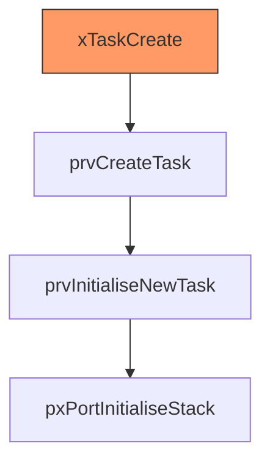
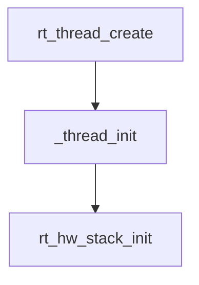
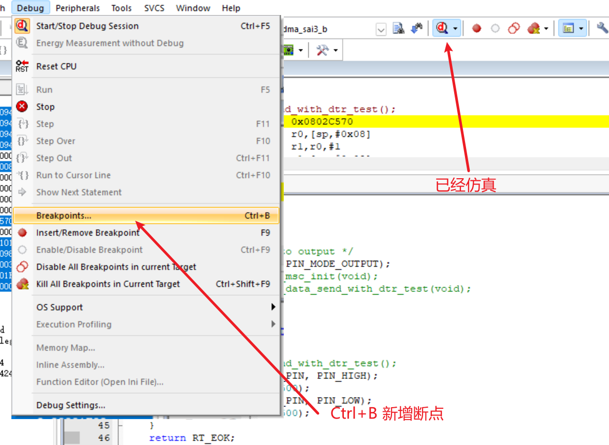
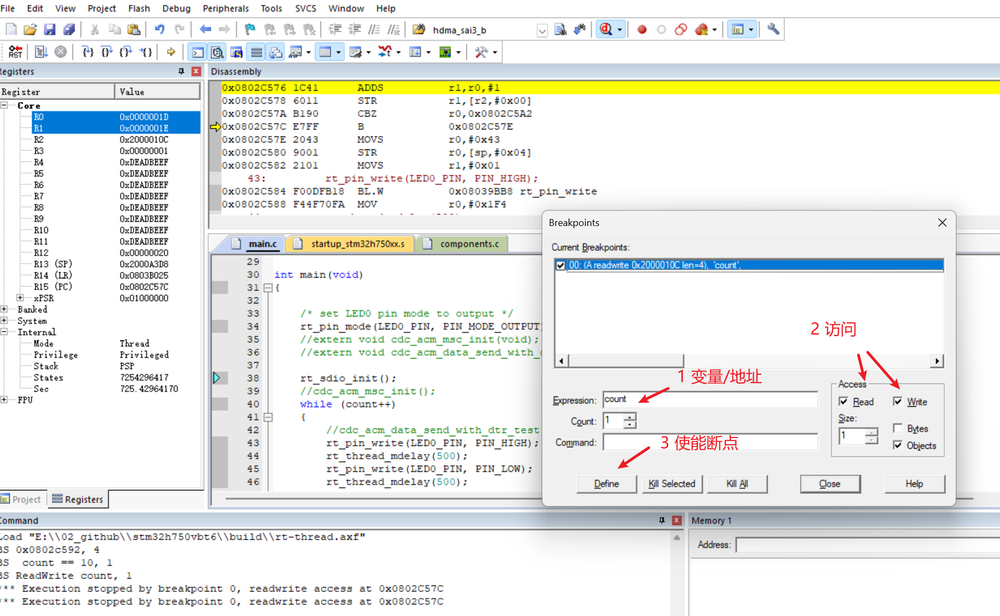
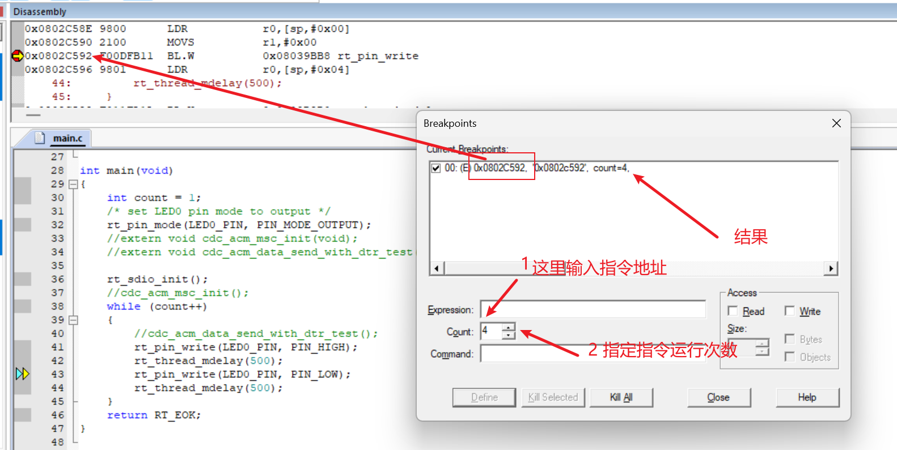
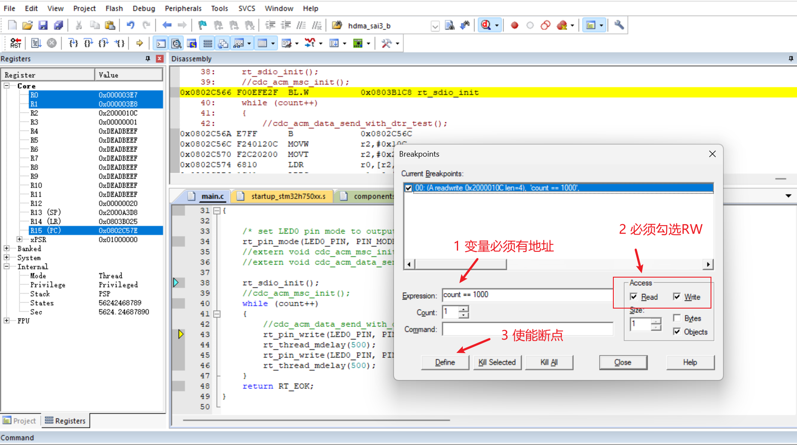
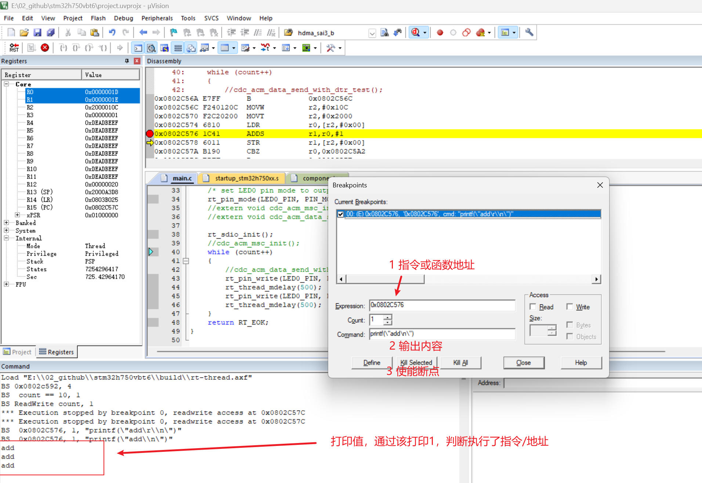
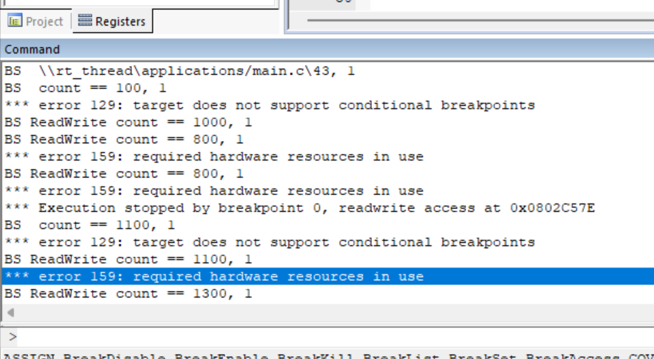

# 单片机调试

[视频链接](https://www.bilibili.com/video/BV1bB4y1q72a?spm_id_from=333.788.player.switch&vd_source=2e33a3cba9dea05126d330dcf100be27&p=3)

## 必备知识

### FreeRTOS

#### 任务块结构体

```c
typedef struct tskTaskControlBlock       /* The old naming convention is used to prevent breaking kernel aware debuggers. */
{
    //任务栈的实时栈顶
    volatile StackType_t * pxTopOfStack; /**< Points to the location of the last item placed on the tasks stack.  THIS MUST BE THE FIRST MEMBER OF THE TCB STRUCT. */
    ******
    ListItem_t xEventListItem;                  /**< Used to reference a task from an event list. */
    UBaseType_t uxPriority;                     /**< The priority of the task.  0 is the lowest priority. */
    //任务栈的起始地址
    StackType_t * pxStack;                      /**< Points to the start of the stack. */
    *******
} tskTCB;

/* The old tskTCB name is maintained above then typedefed to the new TCB_t name
 * below to enable the use of older kernel aware debuggers. */
typedef tskTCB TCB_t;
```

#### 任务初始化调用关系



#### 任务栈缓存内容

由函数内容可见，**栈内容为R0~R15，还有一个xPSR，如果内核带有浮点数，栈内容还需要包含浮点寄存器**.

查看port.c文件

```c
/* 可以看到FreeRTOS是如何给线程一个初始现场的 */
StackType_t * pxPortInitialiseStack( StackType_t * pxTopOfStack,
                                     TaskFunction_t pxCode,
                                     void * pvParameters )
{
    /* Simulate the stack frame as it would be created by a context switch
     * interrupt. */

    /* Offset added to account for the way the MCU uses the stack on entry/exit
     * of interrupts, and to ensure alignment. */
    pxTopOfStack--;

    *pxTopOfStack = portINITIAL_XPSR;                                    /* xPSR */
    pxTopOfStack--;
    *pxTopOfStack = ( ( StackType_t ) pxCode ) & portSTART_ADDRESS_MASK; /* PC */
    pxTopOfStack--;
    *pxTopOfStack = ( StackType_t ) portTASK_RETURN_ADDRESS;             /* LR */

    /* Save code space by skipping register initialisation. */
    pxTopOfStack -= 5;                            /* R12, R3, R2 and R1. */
    *pxTopOfStack = ( StackType_t ) pvParameters; /* R0 */

    /* A save method is being used that requires each task to maintain its
     * own exec return value. */
    pxTopOfStack--;
    *pxTopOfStack = portINITIAL_EXC_RETURN;

    pxTopOfStack -= 8; /* R11, R10, R9, R8, R7, R6, R5 and R4. */

    return pxTopOfStack;
}

/* M3内核：RTOS在PendSV异常内保存当前任务线程，然后恢复下一个任务现场 */
void xPortPendSVHandler( void )
{
    /* This is a naked function. */

    __asm volatile
    (
        "   mrs r0, psp                         \n"
        "   isb                                 \n"
        "                                       \n"
        "   ldr r3, =pxCurrentTCB               \n" /* Get the location of the current TCB. */
        "   ldr r2, [r3]                        \n"
        "                                       \n"
        "   stmdb r0!, {r4-r11}                 \n" /* Save the remaining registers. */
        "   str r0, [r2]                        \n" /* Save the new top of stack into the first member of the TCB. */
        "                                       \n"
        "   stmdb sp!, {r3, r14}                \n"
        "   mov r0, %0                          \n"
        "   msr basepri, r0                     \n"
        "   bl vTaskSwitchContext               \n"
        "   mov r0, #0                          \n"
        "   msr basepri, r0                     \n"
        "   ldmia sp!, {r3, r14}                \n"
        "                                       \n" /* Restore the context, including the critical nesting count. */
        "   ldr r1, [r3]                        \n"
        "   ldr r0, [r1]                        \n" /* The first item in pxCurrentTCB is the task top of stack. */
        "   ldmia r0!, {r4-r11}                 \n" /* Pop the registers. */
        "   msr psp, r0                         \n"
        "   isb                                 \n"
        "   bx r14                              \n"
        "                                       \n"
        "   .ltorg                              \n"
        ::"i" ( configMAX_SYSCALL_INTERRUPT_PRIORITY )
    );
}

/*M7内核*/
void xPortPendSVHandler( void )
{
    /* This is a naked function. */

    __asm volatile
    (
        "   mrs r0, psp                         \n"
        "   isb                                 \n"
        "                                       \n"
        "   ldr r3, =pxCurrentTCB               \n" /* Get the location of the current TCB. */
        "   ldr r2, [r3]                        \n"
        "                                       \n"
        "   tst r14, #0x10                      \n" /* Is the task using the FPU context?  If so, push high vfp registers. */
        "   it eq                               \n"
        "   vstmdbeq r0!, {s16-s31}             \n"
        "                                       \n"
        "   stmdb r0!, {r4-r11, r14}            \n" /* Save the core registers. */
        "   str r0, [r2]                        \n" /* Save the new top of stack into the first member of the TCB. */
        "                                       \n"
        "   stmdb sp!, {r0, r3}                 \n"
        "   mov r0, %0                          \n"
        "   cpsid i                             \n" /* ARM Cortex-M7 r0p1 Errata 837070 workaround. */
        "   msr basepri, r0                     \n"
        "   dsb                                 \n"
        "   isb                                 \n"
        "   cpsie i                             \n" /* ARM Cortex-M7 r0p1 Errata 837070 workaround. */
        "   bl vTaskSwitchContext               \n"
        "   mov r0, #0                          \n"
        "   msr basepri, r0                     \n"
        "   ldmia sp!, {r0, r3}                 \n"
        "                                       \n"
        "   ldr r1, [r3]                        \n" /* The first item in pxCurrentTCB is the task top of stack. */
        "   ldr r0, [r1]                        \n"
        "                                       \n"
        "   ldmia r0!, {r4-r11, r14}            \n" /* Pop the core registers. */
        "                                       \n"
        "   tst r14, #0x10                      \n" /* Is the task using the FPU context?  If so, pop the high vfp registers too. */
        "   it eq                               \n"
        "   vldmiaeq r0!, {s16-s31}             \n"
        "                                       \n"
        "   msr psp, r0                         \n"
        "   isb                                 \n"
        "                                       \n"
        #ifdef WORKAROUND_PMU_CM001 /* XMC4000 specific errata workaround. */
            #if WORKAROUND_PMU_CM001 == 1
                "           push { r14 }                \n"
                "           pop { pc }                  \n"
            #endif
        #endif
        "                                       \n"
        "   bx r14                              \n"
        "                                       \n"
        "   .ltorg                              \n"
        ::"i" ( configMAX_SYSCALL_INTERRUPT_PRIORITY )
    );
}
```

### Rt-Thread

#### 任务块结构体

```
struct rt_thread
{
    /* stack point and entry */
    //任务栈的实时栈顶
    void       *sp;                                     /**< stack point */
    void       *entry;                                  /**< entry */
    void       *parameter;                              /**< parameter */
    //任务栈起始地址
    void       *stack_addr;                             /**< stack address */
    rt_uint32_t stack_size;                             /**< stack size */
};
typedef struct rt_thread *rt_thread_t;
```

#### 任务初始化调用关系

注意，初始化时，栈会被全部赋值为'#'(0x23)



#### 任务栈缓存内容

查看cpuport.c

由函数内容可见，**栈内容为R0~R15，还有一个xPSR，如果内核带有浮点数，栈内容还需要包含浮点寄存器**.

```c
// 初始任务现场
rt_uint8_t *rt_hw_stack_init(void       *tentry,
                             void       *parameter,
                             rt_uint8_t *stack_addr,
                             void       *texit)
{
    struct stack_frame *stack_frame;
    rt_uint8_t         *stk;
    unsigned long       i;

    stk  = stack_addr + sizeof(rt_uint32_t);
    stk  = (rt_uint8_t *)RT_ALIGN_DOWN((rt_uint32_t)stk, 8);
    stk -= sizeof(struct stack_frame);

    stack_frame = (struct stack_frame *)stk;

    /* init all register */
    for (i = 0; i < sizeof(struct stack_frame) / sizeof(rt_uint32_t); i ++)
    {
        ((rt_uint32_t *)stack_frame)[i] = 0xdeadbeef;
    }

    stack_frame->exception_stack_frame.r0  = (unsigned long)parameter; /* r0 : argument */
    stack_frame->exception_stack_frame.r1  = 0;                        /* r1 */
    stack_frame->exception_stack_frame.r2  = 0;                        /* r2 */
    stack_frame->exception_stack_frame.r3  = 0;                        /* r3 */
    stack_frame->exception_stack_frame.r12 = 0;                        /* r12 */
    stack_frame->exception_stack_frame.lr  = (unsigned long)texit;     /* lr */
    stack_frame->exception_stack_frame.pc  = (unsigned long)tentry;    /* entry point, pc */
    stack_frame->exception_stack_frame.psr = 0x01000000L;              /* PSR */

#if USE_FPU
    stack_frame->flag = 0;
#endif /* USE_FPU */

    /* return task's current stack address */
    return stk;
}


```

## 栈回溯调试单片机

主要依据是通过栈保存的LR寄存器，找出函数调用关系。

**其实RT-Thread已经做好了栈回溯功能，参考cpuport内的函数即可。**

[CmBacktrace](https://github.com/armink/CmBacktrace)做的比较完善，可以移植

### 补充知识

当 CPU 进入中断服务程序（ISR）时，LR 会被自动填充为一个特殊的值。当函数执行完毕准备返回时，如果 CPU 检测到 LR 的值是这些特殊码，它就会知道：“这不是一次普通的函数返回，而是一次**从异常状态恢复**的操作”。

| **EXC_RETURN 值** | **返回后的模式** | **返回后的堆栈指针** | **含义**                               |
| ----------------- | ---------------- | -------------------- | -------------------------------------- |
| **0xFFFFFFF1**    | Handler Mode     | MSP (Main)           | 返回到中断嵌套中（继续处理另一个中断） |
| **0xFFFFFFF9**    | Thread Mode      | MSP (Main)           | 返回到主程序（使用主堆栈）             |
| **0xFFFFFFFD**    | Thread Mode      | PSP (Process)        | 返回到用户任务（RTOS 任务切换最常用）  |
| **0xFFFFFFE1**    | Handler Mode     | MSP (Main)           | 涉及浮点单元（FPU）的返回              |
| **0xFFFFFFED**    | Thread Mode      | PSP (Process)        | 涉及浮点单元（FPU）的返回              |

指令集概述

| **内核系列**          | **主要指令集** | **指令宽度**     | **LR 中的返回地址**  | **物理内存中的指令地址** |
| --------------------- | -------------- | ---------------- | -------------------- | ------------------------ |
| **Cortex-M0**         | Thumb (大部分) | 16-bit           | **Bit0 = 1**         | **Bit0 = 0 **            |
| **Cortex-M3/M4/M7**   | **Thumb-2**    | 混合 (16/32-bit) | **Bit0 = 1**         | **Bit0 = 0 **            |
| **Cortex-A/R (32位)** | ARM & Thumb-2  | 32-bit 或 混合   | 0 (ARM) 或 1 (Thumb) | 0 (ARM) 或 1 (Thumb)     |

函数调用栈保存寄存器类型

| **寄存器类型**         | **具体寄存器**       | **谁负责保护** | **备注**                                     |
| ---------------------- | -------------------- | -------------- | -------------------------------------------- |
| **调用者保存寄存器**   | R0-R3, R12, LR, xPSR | 调用者         | 用于参数传递和返回值，子函数可随意改         |
| **被调用者保存寄存器** | R4-R11               | 被调用子函数   | 用于保存局部变量，子函数用之前必存，用完必还 |
| **特殊**               | SP (R13), PC (R15)   | 系统/指令流    | 维持程序运行的核心指针                       |

在反汇编中，Thumb指令集地址的bit0为0，**在LR寄存器中，bit0为1**。LR中bit0为1主要是告诉CPU当前指令为thumb指令集

### 步骤

#### 1. 对axf文件进行反汇编

```cmd
# elf文件反汇编
arm-none-eabi-objdump -d -S test.elf > test.dis
# axf文件反汇编
fromelf --text -c --output=test.dis test.axf
```

#### 2. 编写代码，在异常hardfault内输出寄存器值

```c
//arm-none-gcc编译器

struct exception_stack_frame
{
    uint32_t exc_return;
    uint32_t r4;
    uint32_t r5;
    uint32_t r6;
    uint32_t r7;
    uint32_t r8;
    uint32_t r9;
    uint32_t r10;
    uint32_t r11;
    uint32_t r0;
    uint32_t r1;
    uint32_t r2;
    uint32_t r3;
    uint32_t r12;
    uint32_t lr;
    uint32_t pc;
    uint32_t psr;
};

void HardFault_Handler(void)
{
    extern void rt_hw_hard_fault_exception(struct exception_stack_frame * exception_info);

     __asm volatile("TST   LR, #4\n"
                   "ITE   EQ\n"
                   "MRSEQ R0, MSP\n"
                   "MRSNE R0, PSP\n"

                   /* 手动在栈上移动 R0，为 R4-R11 和 LR 预留空间 (9个字 = 36字节) */
                   /* 然后用 STM 直接存，或者维持 STMFD 但确保 C 结构体对应 */
                   "STMFD R0!, {R4-R11, LR}\n"

                   /* 更新 SP 到新的位置，这样 C 函数处理的就是这一整块内存 */
                   "TST   LR, #4\n"
                   "ITE   EQ\n"
                   "MSREQ MSP, R0\n"
                   "MSRNE PSP, R0\n"

                   "PUSH  {R4, LR}\n"
                   "BL    rt_hw_hard_fault_exception\n"
                   "POP   {R4, LR}\n"

                   /* 恢复现场：如果需要从 HardFault 返回（通常不建议，除非是特定的异常测试） */
                   "LDMFD R0!, {R4-R11, LR}\n"
                   "TST   LR, #4\n"
                   "ITE   EQ\n"
                   "MSREQ MSP, R0\n"
                   "MSRNE PSP, R0\n"

                   "BX    LR\n"
                   :
                   :
                   : "r0", "memory" /* 显式告诉编译器 R0 被动过了 */
    );
}


void rt_hw_hard_fault_exception(struct exception_stack_frame* exception_info)
{
    unsigned int* app_sp;

    int i;
    app_sp = (unsigned int*)(exception_info + 1); /* context + 16*4 */

    printf("psr: 0x%08x\r\n", exception_info->psr);
    printf("r00: 0x%08x\r\n", exception_info->r0);
    printf("r01: 0x%08x\r\n", exception_info->r1);
    printf("r02: 0x%08x\r\n", exception_info->r2);
    printf("r03: 0x%08x\r\n", exception_info->r3);
    printf("r04: 0x%08x\r\n", exception_info->r4);
    printf("r05: 0x%08x\r\n", exception_info->r5);
    printf("r06: 0x%08x\r\n", exception_info->r6);
    printf("r07: 0x%08x\r\n", exception_info->r7);
    printf("r08: 0x%08x\r\n", exception_info->r8);
    printf("r09: 0x%08x\r\n", exception_info->r9);
    printf("r10: 0x%08x\r\n", exception_info->r10);
    printf("r11: 0x%08x\r\n", exception_info->r11);
    printf("r12: 0x%08x\r\n", exception_info->r12);
    printf(" lr: 0x%08x\r\n", exception_info->lr);
    printf(" pc: 0x%08x\r\n", exception_info->pc);

    printf("stacks: \r\n");
    i = 0;
    for (i = 0; i < 1024;) {
        printf("%08x ", *app_sp);
        app_sp++;
        i++;
        if (i % 16 == 0)
            printf("\r\n");
    }
    printf("\r\n");

    while (1)
        ;
}
```

#### 3. 测试函数

```c
void DIV(int val)
{
    FUNC_ENTRY();
    int result = 100 / val;
    printf("rst: %d\r\n", result);
    FUNC_EXIT();
}

void A(void)
{
    FUNC_ENTRY();
    DIV(0); /* 触发除零异常 */
    FUNC_EXIT();
}

void B(void)
{
    FUNC_ENTRY();
    A();
    FUNC_EXIT();
}

void C(void)
{
    FUNC_ENTRY();
    B();
    FUNC_EXIT();
}

static void test_debug(void)
{
    //使能除0异常
    SCB->CCR |= SCB_CCR_DIV_0_TRP_Msk;

    FUNC_ENTRY();
    C();
    FUNC_EXIT();
}
```

#### 4. 根据hard fault输出，找到产生hard fault的指令位置

[分析](./hardfault分析.excalidraw)

### 总结

栈值为0x0800xxxx，可以认为这是一个函数地址

注意LR寄存器的bit0是1,这样可以快速找到LR寄存器，如下图框起来的值


一次性断点，由串口输出栈信息，排查出问题

## 一次性断点调试

### 补充知识

#### 1. 软件断点：灵活但有局限

- **它是怎么工作的？** 当你点下断点，调试器记下原指令（比如 `MOV R0, #1`），然后把该处改成 `BKPT`（只要CPU不识别都行）。程序运行到这时触发异常，进入调试模式。你点“下一步”时，调试器再把原指令换回来。
- **局限性**：在 Flash 中运行的代码，设置软件断点需要擦除并重写 Flash 扇区，这非常慢，且会消耗 Flash 寿命。所以很多调试器在 Flash 环境下默认只允许使用硬件断点。

#### 2. 硬件断点：稀有且强大

- **它是怎么工作的？** CPU 内部有几个“狙击手”（比较器）。调试器配置：“只要地址总线出现 `0x08001234`，立刻停火。”，那么当比较器检测到总线出现0x08001234后，就会产生断点。
- **必选场景**：
  - **调试 Flash 中的代码**（ROM 固件）。
  - **代码自校验**：有些系统会校验自身的校验和（Checksum），如果用软件断点改了代码，校验会失败，这时必须用硬件断点。

### 步骤

#### 1. 对可执行文件反汇编

```shell
# elf文件反汇编
arm-none-eabi-objdump -d -S test.elf > test.dis
# axf文件反汇编
fromelf --text -c --output=test.dis test.axf
```

#### 2. 找到需要打断点的地方，此处以8001a18为例


#### 3. 烧录修改后的文件

```shell
 pyocd flash -t STM32H750VBTx ./build/Debug/stm32h750-freertos.bin@0x08000000
```

#### 4. 分析


### 总结

出现问题后，固定elf/axf/和bin文件。然后按照修改bin文件指令的办法查看日志输出，逐步分析问题。

由此可见，版本管理是相当重要的

## 修改bin实现多个断点

相对于[一次性断点调试](#一次性断点调试),多个断点的实现方式是多了两处内容，**替换指令使用SVC指令，新增SVC内模拟被替换指令的功能**。

## KEIL调试



### 变量/内存被读写



### 指令/函数运行指定次数



### 监测变量等于固定值



### 不复位断点



### command窗口

窗口可以输入断点指令和查看不服为断点的打印



## GDB调试

GDB也可以实现类似KEIL的断点，后期补充

## 仿真器无法确认RTOS卡死位置

如果某一个线程阻塞，死循环，异常延时等情况，仿真器暂停后，**不一定会停止在卡死的位置**。

这个时候根据**RTOS切换逻辑，将任务运行现场保存到栈后，再切换到另一个任务**。只需要找到卡死的任务栈，然后分析栈内保存的寄存器值（PC存储当前运行指令，LR存储当前函数返回的地址）。

**关键是找到卡死的任务栈**