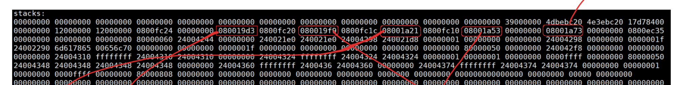
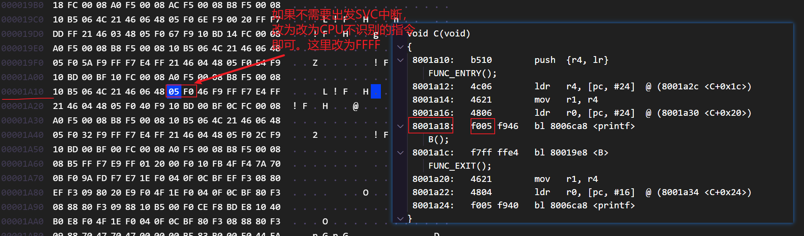
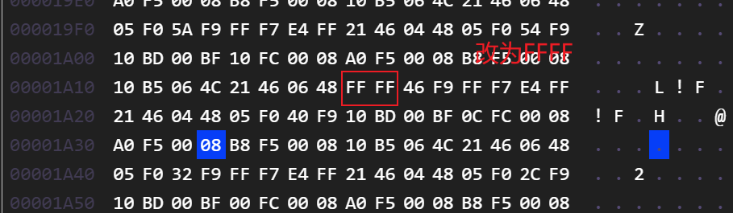
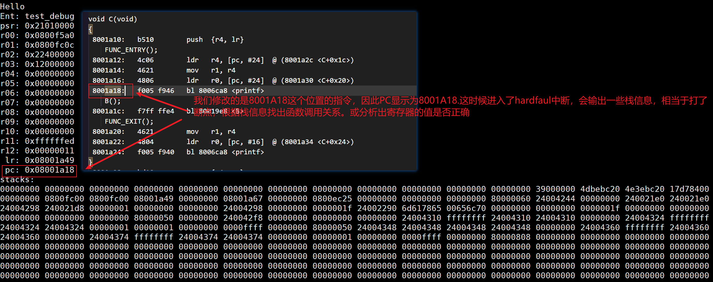

# 单片机调试

[视频链接](https://www.bilibili.com/video/BV1bB4y1q72a?spm_id_from=333.788.player.switch&vd_source=2e33a3cba9dea05126d330dcf100be27&p=3)

## 栈回溯调试单片机

主要依据是通过栈保存的LR寄存器，找出函数调用关系。

**其实RT-Thread已经做好了栈回溯功能，参考cpuport内的函数即可。**

[CmBacktrace](https://github.com/armink/CmBacktrace)做的比较完善，可以移植

### 补充知识

指令集概述

| **内核系列**          | **主要指令集** | **指令宽度**     | **LR 中的返回地址**  | **物理内存中的指令地址** |
| --------------------- | -------------- | ---------------- | -------------------- | ------------------------ |
| **Cortex-M0**         | Thumb (大部分) | 16-bit           | **Bit0 = 1**         | **Bit0 = 0 **            |
| **Cortex-M3/M4/M7**   | **Thumb-2**    | 混合 (16/32-bit) | **Bit0 = 1**         | **Bit0 = 0 **            |
| **Cortex-A/R (32位)** | ARM & Thumb-2  | 32-bit 或 混合   | 0 (ARM) 或 1 (Thumb) | 0 (ARM) 或 1 (Thumb)     |

函数调用栈保存寄存器类型

| **寄存器类型**         | **具体寄存器**       | **谁负责保护** | **备注**                                     |
| ---------------------- | -------------------- | -------------- | -------------------------------------------- |
| **调用者保存寄存器**   | R0-R3, R12, LR, xPSR | 调用者         | 用于参数传递和返回值，子函数可随意改         |
| **被调用者保存寄存器** | R4-R11               | 被调用子函数   | 用于保存局部变量，子函数用之前必存，用完必还 |
| **特殊**               | SP (R13), PC (R15)   | 系统/指令流    | 维持程序运行的核心指针                       |

在反汇编中，Thumb指令集地址的bit0为0，**在LR寄存器中，bit0为1**。LR中bit0为1主要是告诉CPU当前指令为thumb指令集

### 步骤

#### 1. 对axf文件进行反汇编

```cmd
# elf文件反汇编
arm-none-eabi-objdump -d -S test.elf > test.dis
# axf文件反汇编
fromelf --text -c --output=test.dis test.axf
```

#### 2. 编写代码，在异常hardfault内输出寄存器值

```c
//arm-none-gcc编译器

struct exception_stack_frame
{
    uint32_t exc_return;
    uint32_t r4;
    uint32_t r5;
    uint32_t r6;
    uint32_t r7;
    uint32_t r8;
    uint32_t r9;
    uint32_t r10;
    uint32_t r11;
    uint32_t r0;
    uint32_t r1;
    uint32_t r2;
    uint32_t r3;
    uint32_t r12;
    uint32_t lr;
    uint32_t pc;
    uint32_t psr;
};

void HardFault_Handler(void)
{
    extern void rt_hw_hard_fault_exception(struct exception_stack_frame * exception_info);

     __asm volatile("TST   LR, #4\n"
                   "ITE   EQ\n"
                   "MRSEQ R0, MSP\n"
                   "MRSNE R0, PSP\n"

                   /* 手动在栈上移动 R0，为 R4-R11 和 LR 预留空间 (9个字 = 36字节) */
                   /* 然后用 STM 直接存，或者维持 STMFD 但确保 C 结构体对应 */
                   "STMFD R0!, {R4-R11, LR}\n"

                   /* 更新 SP 到新的位置，这样 C 函数处理的就是这一整块内存 */
                   "TST   LR, #4\n"
                   "ITE   EQ\n"
                   "MSREQ MSP, R0\n"
                   "MSRNE PSP, R0\n"

                   "PUSH  {R4, LR}\n"
                   "BL    rt_hw_hard_fault_exception\n"
                   "POP   {R4, LR}\n"

                   /* 恢复现场：如果需要从 HardFault 返回（通常不建议，除非是特定的异常测试） */
                   "LDMFD R0!, {R4-R11, LR}\n"
                   "TST   LR, #4\n"
                   "ITE   EQ\n"
                   "MSREQ MSP, R0\n"
                   "MSRNE PSP, R0\n"

                   "BX    LR\n"
                   :
                   :
                   : "r0", "memory" /* 显式告诉编译器 R0 被动过了 */
    );
}


void rt_hw_hard_fault_exception(struct exception_stack_frame* exception_info)
{
    unsigned int* app_sp;

    int i;
    app_sp = (unsigned int*)(exception_info + 1); /* context + 16*4 */

    printf("psr: 0x%08x\r\n", exception_info->psr);
    printf("r00: 0x%08x\r\n", exception_info->r0);
    printf("r01: 0x%08x\r\n", exception_info->r1);
    printf("r02: 0x%08x\r\n", exception_info->r2);
    printf("r03: 0x%08x\r\n", exception_info->r3);
    printf("r04: 0x%08x\r\n", exception_info->r4);
    printf("r05: 0x%08x\r\n", exception_info->r5);
    printf("r06: 0x%08x\r\n", exception_info->r6);
    printf("r07: 0x%08x\r\n", exception_info->r7);
    printf("r08: 0x%08x\r\n", exception_info->r8);
    printf("r09: 0x%08x\r\n", exception_info->r9);
    printf("r10: 0x%08x\r\n", exception_info->r10);
    printf("r11: 0x%08x\r\n", exception_info->r11);
    printf("r12: 0x%08x\r\n", exception_info->r12);
    printf(" lr: 0x%08x\r\n", exception_info->lr);
    printf(" pc: 0x%08x\r\n", exception_info->pc);

    printf("stacks: \r\n");
    i = 0;
    for (i = 0; i < 1024;) {
        printf("%08x ", *app_sp);
        app_sp++;
        i++;
        if (i % 16 == 0)
            printf("\r\n");
    }
    printf("\r\n");

    while (1)
        ;
}
```

#### 3. 测试函数

```c
void DIV(int val)
{
    FUNC_ENTRY();
    int result = 100 / val;
    printf("rst: %d\r\n", result);
    FUNC_EXIT();
}

void A(void)
{
    FUNC_ENTRY();
    DIV(0); /* 触发除零异常 */
    FUNC_EXIT();
}

void B(void)
{
    FUNC_ENTRY();
    A();
    FUNC_EXIT();
}

void C(void)
{
    FUNC_ENTRY();
    B();
    FUNC_EXIT();
}

static void test_debug(void)
{
    //使能除0异常
    SCB->CCR |= SCB_CCR_DIV_0_TRP_Msk;

    FUNC_ENTRY();
    C();
    FUNC_EXIT();
}
```

#### 4. 根据hard fault输出，找到产生hard fault的指令位置

[分析](./hardfault分析.excalidraw)

### 总结

栈值为0x0800xxxx，可以认为这是一个函数地址

注意LR寄存器的bit0是1,这样可以快速找到LR寄存器，如下图框起来的值



一次性断点，由串口输出栈信息，排查出问题

## 一次性断点调试

### 补充知识

#### 1. 软件断点：灵活但有局限

- **它是怎么工作的？** 当你点下断点，调试器记下原指令（比如 `MOV R0, #1`），然后把该处改成 `BKPT`（只要CPU不识别都行）。程序运行到这时触发异常，进入调试模式。你点“下一步”时，调试器再把原指令换回来。
- **局限性**：在 Flash 中运行的代码，设置软件断点需要擦除并重写 Flash 扇区，这非常慢，且会消耗 Flash 寿命。所以很多调试器在 Flash 环境下默认只允许使用硬件断点。

#### 2. 硬件断点：稀有且强大

- **它是怎么工作的？** CPU 内部有几个“狙击手”（比较器）。调试器配置：“只要地址总线出现 `0x08001234`，立刻停火。”，那么当比较器检测到总线出现0x08001234后，就会产生断点。
- **必选场景**：
  - **调试 Flash 中的代码**（ROM 固件）。
  - **代码自校验**：有些系统会校验自身的校验和（Checksum），如果用软件断点改了代码，校验会失败，这时必须用硬件断点。

### 步骤

#### 1. 对可执行文件反汇编

```shell
# elf文件反汇编
arm-none-eabi-objdump -d -S test.elf > test.dis
# axf文件反汇编
fromelf --text -c --output=test.dis test.axf
```

#### 2. 找到需要打断点的地方，此处以8001a18为例





#### 3. 烧录修改后的文件

```shell
 pyocd flash -t STM32H750VBTx ./build/Debug/stm32h750-freertos.bin@0x08000000
```

#### 4. 分析



### 总结

出现问题后，固定elf/axf/和bin文件。然后按照修改bin文件指令的办法查看日志输出，逐步分析问题。

由此可见，版本管理是相当重要的

## 修改bin实现多个断点

相对于[一次性断点调试](#一次性断点调试),多个断点的实现方式是多了两处内容，**替换指令使用SVC指令，新增SVC内模拟被替换指令的功能**。